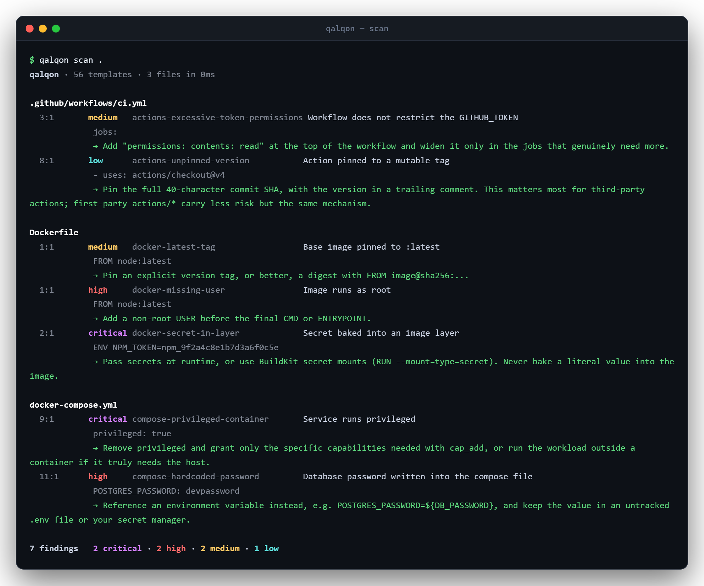
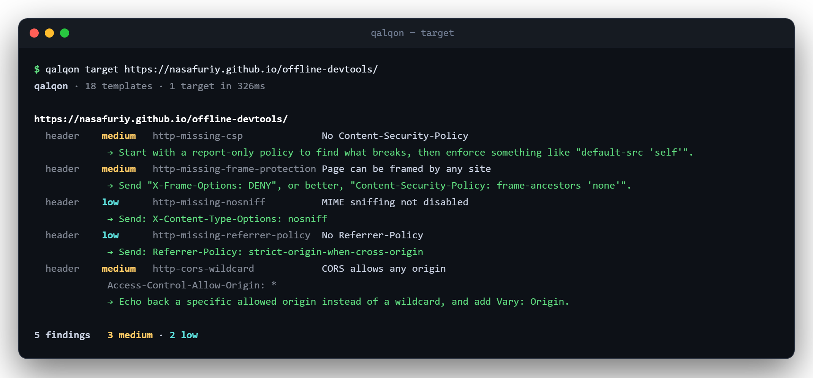

<div align="center">

# Qalqon

**Find the configuration mistake before it ships.**

A single Go binary that scans a repository for insecure Docker, Compose, Kubernetes,
Terraform, nginx, Apache, sshd, systemd, PHP and GitHub Actions configuration — and for
credentials that should never have been committed. It can also check the security
headers and TLS posture of hosts you run.

[](https://go.dev)
[](LICENSE)
[](#install)
[](templates/)



</div>

---

Every finding names the file and line, shows the text that matched, and tells you what
to do instead. The exit code is `1`, so CI stops.

## Why another scanner

There are excellent, thorough tools in this space — `trivy`, `checkov`, `kics`. They
scan far more than Qalqon does. Qalqon is built around three choices they did not make:

- **One binary, no configuration.** Download it and run `qalqon .`. There is no config
  file to write, no policy language to learn, no container to pull, no Python
  environment to solve.
- **Templates you can write during a code review.** A rule is a short YAML document:
  which files, what pattern. If you hit a mistake twice, writing the rule that catches
  it the third time takes about two minutes.
- **Findings you can act on.** Every template must carry a remediation line, enforced
  by the test suite. A finding that does not tell you what to do is noise.

If you need exhaustive compliance coverage, use one of the others. If you want a fast
check that runs on every commit and that your team will actually keep enabled, that is
what this is for.

## Install

```bash
go install github.com/nasafuriy/qalqon/cmd/qalqon@latest
```

Or download a binary for your platform from [Releases](https://github.com/nasafuriy/qalqon/releases)
and put it on your `PATH`. There is nothing else to install — the template library is
compiled into the binary, so it works with no network access.

## Use

```bash
qalqon .                                # scan the working tree
qalqon scan ./infra -severity high,critical
qalqon scan . -tags docker,kubernetes
qalqon scan . -fail-on high             # only fail CI on high and above
qalqon scan . -json -o findings.json
qalqon templates                        # list every rule that would run
```

Useful flags:

| Flag | What it does |
|---|---|
| `-severity LIST` | only run rules at these severities |
| `-min-severity S` | drop everything below `S` |
| `-tags LIST` | select by technology: `docker`, `k8s`, `nginx`, `secret`, … |
| `-id LIST` | run named rules only |
| `-exclude GLOB` | skip paths |
| `-t DIR` | add your own template directory |
| `-no-builtin` | run only your templates |
| `-c N` | worker count, defaults to one per core |
| `-fail-on S` | severity that makes the exit code `1` (default `low`, `none` disables) |

## Checking a live host

`qalqon target` reads the security headers, cookie flags and TLS state of a running
service:



```bash
qalqon target example.com                    # bare host is treated as https
qalqon target -l my-domains.txt              # one per line
qalqon target https://a.example https://b.example -json
```

**Scope, deliberately.** Each target gets exactly one ordinary GET — the same request a
browser makes when you type the address. There is no path guessing, no payloads, no
authentication attempts, and concurrency is capped at ten. That is enough to audit your
own infrastructure and not enough to be useful against anyone else's. **Only probe hosts
you operate or are authorised to test.**

Rules address the response by part:

| Part | Contains |
|---|---|
| `header` | the status line plus one `Name: value` line per header |
| `body` | the response body, up to `-max-body` |
| `status` | the status code |
| `url` | the final URL after redirects |
| `tls` | negotiated version, cipher, and certificate facts |

The `tls` part is rendered as text so a pattern can match it, with the date arithmetic
already done:

```
version: TLS 1.3
issuer: E5
not_after: 2026-11-02T09:14:00Z
days_remaining: 81
expired: false
expires_within_30d: false
self_signed: false
hostname_mismatch: false
key_bits: 256
```

When the certificate fails verification the probe retries without it, so a broken chain
is reported rather than turning into a connection error you have to debug by hand.

## In CI

Qalqon emits SARIF, so findings land in the GitHub **Security** tab and appear as inline
annotations on pull requests:

```yaml
name: Config audit
on: [push, pull_request]

permissions:
  contents: read
  security-events: write

jobs:
  qalqon:
    runs-on: ubuntu-latest
    steps:
      - uses: actions/checkout@v4

      - name: Install qalqon
        run: go install github.com/nasafuriy/qalqon/cmd/qalqon@latest

      - name: Scan
        run: qalqon scan . -sarif -o qalqon.sarif -fail-on none

      - uses: github/codeql-action/upload-sarif@v3
        with:
          sarif_file: qalqon.sarif
```

`-fail-on none` lets the upload step run even when findings exist; the Security tab
becomes the place they are triaged. Drop that flag if you would rather fail the build.

## Writing a template

A template is one YAML document. Several can share a file, separated by `---`.

```yaml
id: docker-missing-user
info:
  name: Image runs as root
  severity: high            # info | low | medium | high | critical
  description: >-
    The Dockerfile never switches to an unprivileged user, so the container
    process runs as root.
  remediation: Add a non-root USER before the final CMD or ENTRYPOINT.
  tags: [docker, container, privilege]

files:                       # globs; a pattern with "/" matches the path
  - Dockerfile
  - "*.dockerfile"

condition: and               # how the matchers combine: and (default) | or
matchers:
  - type: regex
    context: true            # must match, but is not the reported location
    patterns:
      - '(?im)^\s*FROM\s+\S+'
  - type: absent             # fires when the pattern is NOT in the file
    patterns:
      - '(?im)^\s*USER\s+\S+'
```

Three matcher types cover almost everything:

| Type | Fires when |
|---|---|
| `regex` | a pattern is found |
| `word` | a literal string is found |
| `absent` | a pattern is **not** found anywhere in the file |

A rule for `qalqon target` sets `type: http`, drops `files`, and gives each matcher a
`part`:

```yaml
id: http-missing-hsts
type: http
info:
  name: HSTS header not sent
  severity: medium
  description: Without HSTS a browser will still try plain HTTP on the next visit.
  remediation: 'Send: Strict-Transport-Security: max-age=31536000; includeSubDomains'
  tags: [http, headers, tls]

condition: and
matchers:
  - part: url
    context: true
    patterns: ['^https://']
  - part: header
    type: absent
    patterns: ['(?im)^strict-transport-security:']
```

Other fields worth knowing:

- `context: true` on a matcher — it gates the rule but never becomes the reported line.
  Use it for "this really is a Kubernetes manifest" checks.
- `once: true` on a template — report one finding per file, for rules about the file as
  a whole.
- `prefilter: [AKIA, ASIA]` — literal strings, any of which must appear before the
  regexes run at all. This is the difference between a fast scan and a slow one on broad
  rules. Every literal must be implied by something the template positively requires.

Patterns are Go [RE2](https://github.com/google/re2/wiki/Syntax): **no lookahead or
lookbehind**. Write them positively.

Check your work:

```bash
qalqon validate ./my-templates
qalqon scan ./testdata -t ./my-templates -no-builtin
```

## Performance

Measured on 32 cores over the Go standard library source tree:

| | |
|---|---|
| Files walked | 10,382 |
| Files read | 7,307 |
| Templates | 56 |
| **Wall time** | **339 ms** |
| Single worker (`-c 1`) | ~7 s |

Two things make that possible. Files are only read when a template's file globs already
matched the name, so most of a tree is skipped without touching the disk. Then
`prefilter` rules out a template with a plain substring search before any regex runs —
that alone took this scan from 922 ms to 261 ms.

## Development

```bash
go test ./...              # unit tests plus fixture scans
go build ./cmd/qalqon
qalqon scan testdata/vulnerable    # should report findings
qalqon scan testdata/clean         # must report none
```

The `testdata/clean` tree is the false-positive guard, and it matters more than the
detection test: a scanner that cries wolf gets switched off, and then it protects
nothing. Every new template needs a case in both trees.

## Contributing

New templates are the most useful thing you can add — see [CONTRIBUTING.md](CONTRIBUTING.md).
The bar is that the rule must be accurate enough to leave on in CI.

## Licence

[MIT](LICENSE).
